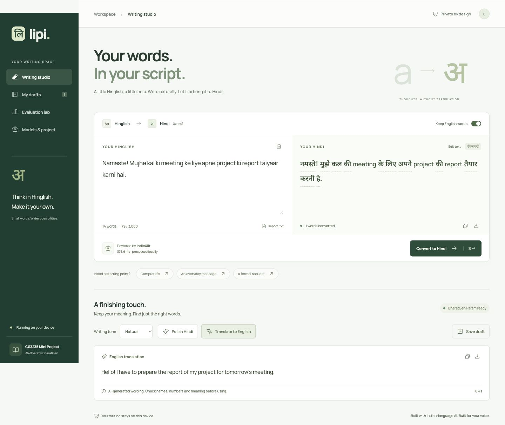
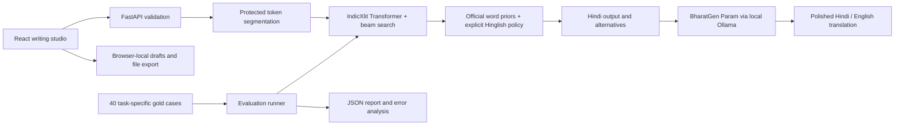

# Lipi · Hinglish Writing Studio

**CS3235 mini-project 4 — Hinglish Smart Writing Assistant**

A working local application that turns Roman Hindi into Devanagari, offers alternate spellings, improves Hindi phrasing, and translates the final message into English. Powered by **AI4Bharat IndicXlit** and **BharatGen Param-1 2.9B Instruct**, with a custom React interface and FastAPI backend. No paid API is required.



## Run on this machine

```bash
./start.sh
```

Open **http://127.0.0.1:8000**. The models and frontend build have already been prepared in this checkout. Ctrl+C stops the application. The script reuses an existing local model server or starts a project-local one.

## Fresh installation

Requirements: Python **3.11**, Node **20.19+ or 22.12+**, npm, and [Ollama](https://ollama.com/download) for the generative features. Tested on Apple M2 Pro / macOS, with CPU transliteration and Metal generation. Windows users can run the Python/backend steps manually; shell scripts target macOS/Linux.

```bash
git clone https://github.com/nghn0/lipi-ai-writing-studio.git
cd lipi-ai-writing-studio
./setup.sh
./start.sh --setup-param
```

`setup.sh` creates `.venv`, installs Python/frontend dependencies, downloads and verifies IndicXlit resources, and builds the frontend. `--setup-param` downloads the pinned ~1.7 GiB community GGUF quantization and imports it into local Ollama. Subsequent launches use `./start.sh` and work offline. Initial setup needs approximately 3 GiB downloads and 6–8 GiB free disk (archives + runtime caches). Allow around 4 GiB RAM for generation; 8 GiB system memory is a practical minimum and 16 GiB recommended. These are engineering estimates, not a hardware benchmark.

If you only need transliteration, skip `--setup-param`; the application labels the generative model unavailable. The exact model versions and SHA-256 checksums are in [`models/provenance.json`](models/provenance.json).

## What works

- Roman Hindi → Devanagari using the actual pretrained IndicXlit weights.
- Four model spelling candidates per converted word; click an underlined Hindi word to choose.
- Word-frequency rescoring using official AI4Bharat priors; a disclosed Hindi function-word policy resolves common ambiguities.
- Toggle English-word preservation; URLs, email addresses, handles, hashtags, numbers, existing native text and whitespace remain protected.
- Natural/formal/friendly Hindi editing and English translation through local BharatGen Param.
- Generation uses the checkpoint’s ChatML template, a one-example translation prompt, temperature 0 and a fixed seed. Wrong-language polishing, changed numeric tokens and truncated responses are withheld. Meaning still requires human review.
- Edit Hindi manually, copy, export UTF-8 text, import `.txt`, save drafts, resume and delete drafts.
- Local browser draft storage, responsive mobile UI, accessible icon names, keyboard focus, loading/error/empty states, reduced-motion support.
- Evaluation lab with 40 gold cases, individual predictions, CER, word accuracy, exact match, category breakdown and failure analysis.

## Architecture



The Python implementation ports Fairseq's pre-norm encoder/decoder, GELU activation, sinusoidal positions and language tags into plain PyTorch. All learned checkpoint parameters load strictly. Runtime loads tensor-only weights with `weights_only=True`. This avoids installing legacy Fairseq on current Apple Silicon/Python. Functional inference is tested; numerical parity with the original Fairseq runtime has **not** been certified. Beam-search implementation and truncated prior vocabulary can differ from upstream rankings.

The function-word map and English vocabulary are product rules, not neural language identification. They are independent of `data/test_cases.json`; the runtime never reads evaluation references. Hindi is the evaluated app language even though the underlying IndicXlit checkpoint supports more languages.

Param uses a **community Q4_K_M quantization** of the official BharatGen checkpoint. It is not an official BharatGen quantization. The translation feature uses Param, **not IndicTrans2**: the official IndicTrans2 checkpoint requires a Hugging Face access agreement. This is an explicit, documented model-selection adaptation.

## Evaluation

```bash
python3 scripts/evaluate.py
python3 scripts/ablation.py
python3 -m pytest -q
```

Use `.venv/bin/python` in place of `python3` after fresh installation. The same evaluation can be run from the app’s Evaluation lab.

Observed on **5 November 2026**, on the 40 manually authored project cases:

| Measure | Result |
|---|---:|
| Character error rate (micro, NFC Unicode code points) | 0.80% |
| Word error rate (micro) | 2.78% |
| Word accuracy, max(0, 1 − WER) | 97.22% |
| Exact sentence match | 36 / 40 |
| Integration checks | 11 passed |

Rescoring ablation: **29/40** exact matches without frequency rescoring, **36/40** with it, with the same Hinglish rules in both configurations. Reproduce rather than treating timing as a fixed benchmark; cache state changes latency.

`CER = Σ edit_distance(reference characters, predicted characters) / Σ reference characters`.
`WER` uses whitespace-delimited words; exact match uses NFC + collapsed whitespace. The normalization means the newline case is a content test, while a separate integration test checks exact whitespace preservation.

The cases span everyday Hindi (10), campus writing (8), spelling variants (6), code switching (6), named entities (4), protected content (6). They are **not an independent research benchmark or Aksharantar held-out evaluation**. They were used during development; do not present these numbers as generalization performance. The separate prompt/translation review sheet is provided, but human fluency/adequacy ratings are intentionally not fabricated.

Artifacts:

- [`data/test_cases.json`](data/test_cases.json): 40 inputs and gold references.
- [`data/evaluation_report.json`](data/evaluation_report.json): full measured results.
- [`data/ablation_report.json`](data/ablation_report.json): reproducible configuration comparison.
- [`docs/FAILURE_ANALYSIS.md`](docs/FAILURE_ANALYSIS.md): observed errors and limitations.
- [`data/generation_smoke.json`](data/generation_smoke.json): real local generation outputs (not human quality scores).
- [`docs/generation_review.csv`](docs/generation_review.csv): human-rating sheet.
- [`docs/PROJECT_REPORT.md`](docs/PROJECT_REPORT.md): academic report and rubric mapping.
- [`docs/DEMO.md`](docs/DEMO.md): demonstration script and viva questions.

## Development

```bash
python3 -m uvicorn backend.app:app --host 127.0.0.1 --port 8000
npm run dev
```

Vite proxies `/api` to FastAPI. Production uses `npm run build` and FastAPI serves `dist/`. API docs: http://127.0.0.1:8000/docs.

| Endpoint | Purpose |
|---|---|
| `GET /api/health` | Actual local model availability |
| `POST /api/transliterate` | `{text, preserve_english, language: "hi"}` |
| `POST /api/generate` | `{text, task: "polish" or "translate", tone}` |
| `GET /api/evaluation` | Read saved measured report |
| `POST /api/evaluation/run` | Recompute the 40-case report |
| `GET /api/examples` | Authored starting examples |

Environment: `LIPI_OLLAMA_URL` (default `http://127.0.0.1:11435`) and `LIPI_PARAM_MODEL` (default `lipi-param:latest`). Export these in your shell; `.env.example` is a reference, and `.env` is not loaded automatically.

## Privacy and limitations

All message inference is local. Drafts persist only in this browser on this origin; clearing browser data deletes them. The unfinished input auto-persists locally. Saved evaluation results are shared within this local checkout. No account, analytics, transcript logging or hosted text API is used. Model downloads contact GitHub/Hugging Face only during setup. Servers bind to loopback; this is a single-user academic app, not a multi-tenant production service.

Word-level transliteration lacks context; main/kal/names can be ambiguous. The finite English vocabulary misses unseen English terms. Param can still produce awkward grammar, change meaning or mishandle names despite prompts and numeric guards. Review output. The number guard compares unique numeric strings, not their multiplicity or semantic role. No RAG or autonomous agent is claimed: this project uses transliteration and instruction prompting, which matches the professor's project 4 scope.

## Attribution and licensing

- [AI4Bharat IndicXlit](https://github.com/AI4Bharat/IndicXlit), MIT; official notice in `models/INDICXLIT-LICENSE`.
- [Aksharantar paper](https://arxiv.org/abs/2205.03018) and [dataset repository](https://github.com/AI4Bharat/IndianNLP-Transliteration). We use the pretrained model; our 40 application cases are separately authored, not sampled from Aksharantar.
- [BharatGen Param-1-2.9B-Instruct](https://huggingface.co/bharatgenai/Param-1-2.9B-Instruct), model-card metadata declares Apache 2.0 at verification time. Do not assume the same license applies to other BharatGen checkpoints.
- [Community GGUF conversion](https://huggingface.co/arunmcops/Param-1-2.9B-Instruct-GGUF), pinned revision in provenance.
- Manrope and Noto Sans Devanagari are bundled through Fontsource; Phosphor icons provide interface icons. Upstream package licenses apply.

The application's original code is MIT licensed. Model weights and third-party assets retain their respective licenses and are not committed to this repository.
